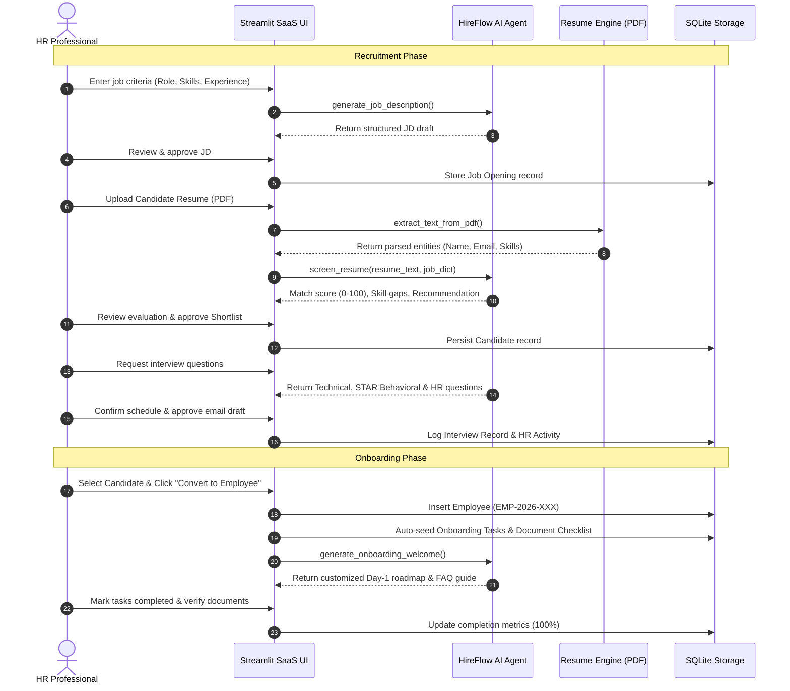

# Academic Project Report: HireFlow AI – Autonomous Recruitment & Onboarding System

**Course Title:** AI Agents & Autonomous Business Operations  
**Project Name:** HireFlow AI – Intelligent Recruitment & Employee Onboarding System  
**System Architecture:** Autonomous Multi-Stage Agent with Human-in-the-Loop Oversight  
**Submission Date:** November 2026  

---

## 1. Executive Summary & Problem Definition

In contemporary enterprise business operations, Human Resource (HR) departments spend upwards of 60% of their operational bandwidth on repetitive, manual workflows:
- Sifting through unstructured candidate resumes
- Scoring candidates against heterogeneous job descriptions
- Formulating standardized yet role-specific interview questionnaires
- Drafting routine communication emails across multiple hiring stages
- Tracking document compliance and onboarding tasks across spreadsheets

**HireFlow AI** was engineered as an autonomous, domain-specific AI Agent designed to automate these routine operational cycles. The system treats recruitment and onboarding not merely as database CRUD forms, but as an **orchestrated autonomous workflow** driven by intelligent perception, reasoning, decision proposal, and verifiable action execution—while preserving essential human governance.

---

## 2. Theoretical Foundations: AI Agents in Autonomous Business Operations

### 2.1 The Agentic Paradigm vs. Static Software
Traditional HRMS applications act as passive repositories. An autonomous business operations agent, by contrast, demonstrates:
1. **Perception**: Ingestion of unstructured inputs (PDF resumes, natural language job criteria, company handbooks).
2. **Reasoning & Deliberation**: Semantic parsing, skill ontology matching, gap analysis, and tailored question generation.
3. **Action Execution**: Updating pipeline states, dispatching audit-logged communications, and generating structured artifacts.
4. **Human-in-the-Loop Governance (HITL)**: Ensuring high-stakes operational choices (candidate rejection, hiring, document clearance) remain under human authority.

### 2.2 Workflow Sequence Diagram

---

## 3. System Architecture & Technical Stack

| Tier | Component | Technology Selected | Rationale |
| :--- | :--- | :--- | :--- |
| **Frontend UI** | Modern SaaS Interface | Streamlit + Custom CSS | High reactivity, clean component hierarchy, rapid deployment |
| **Backend Logic** | Application Orchestrator | Python 3.13 | Standard language for agentic pipelines, thread-safe execution |
| **Database** | Relational Persistence | SQLite 3 | Zero-maintenance serverless relational DB with ACID guarantees |
| **Resume Parser** | Entity & Text Extraction | PDFPlumber & PyPDF2 | Hybrid fallback strategy ensures resilient PDF parsing |
| **AI Intelligence** | LLM & Reasoning Engine | Google Gemini REST API + Deterministic Engine | Seamless dual-mode: live API with smart local fallback |
| **Data Visualization**| Analytics & KPIs | Plotly Express & Graph Objects | Dynamic funnel and donut charts for pipeline transparency |

---

## 4. Key Agent Capabilities & Implementations

### 4.1 Dual-Engine Architecture
To guarantee academic reproducibility across varied testing environments, the agent implements a **Dual-Mode Intelligence Pattern**:
- **Live Gemini API Mode**: Uses REST calls against `gemini-1.5-flash` or `gemini-2.0-flash` with zero SDK deprecation risk.
- **Autonomous Demo Engine**: A domain-specific inference engine executing rule-based skill ontologies, dynamic text synthesis, and contextual FAQ retrieval when no API key is supplied.

### 4.2 Ethical AI & Human-in-the-Loop Safeguards
1. **Non-Autonomous Rejections**: The agent never automatically dismisses a candidate. Match scores and summaries are presented as *advisory recommendations*.
2. **Communication Gatekeeping**: Automated email drafts require explicit human review and an approval checkbox before logging.
3. **Data Anonymity**: Sample datasets use sanitized mock profiles without sensitive personal data (PII).

---

## 5. Verification & Testing Results

An automated integration suite (`test_workflow.py`) validates the entire operational lifecycle:

| Step # | Workflow Stage | Validation Target | Status |
| :---: | :--- | :--- | :---: |
| 1-2 | Job Opening & JD Generation | Synthesizes >1,500 chars structured JD; saves to SQLite | **PASSED** |
| 3-4 | PDF Ingestion & Resume Screening | Parses entities; calculates skill match (0–100%) | **PASSED** |
| 5 | AI Recommendation | Categorizes candidate (`Strong Match`, `Potential`, `Low`) | **PASSED** |
| 6 | HR Shortlisting Approval | Updates candidate status in database | **PASSED** |
| 7 | Interview & Email Generation | Synthesizes 7+ questions across 3 categories; drafts email | **PASSED** |
| 8-9 | Employee Conversion | Generates unique ID (`EMP-2026-002`); seeds onboarding tasks | **PASSED** |
| 10 | AI Welcome Kit | Creates Day-1 agenda, 30-day goals, & HR contacts | **PASSED** |
| 11 | Compliance & Document Tracking | Tracks tasks to completion; updates dashboard metrics | **PASSED** |

---

## 6. Conclusion & Academic Takeaways

HireFlow AI successfully operationalizes core concepts of **AI Agents & Autonomous Business Operations**:
- Demonstrates how agents can relieve human operators of mundane cognitive loads.
- Proves that autonomous workflows must be balanced with strict human oversight for compliance and fairness.
- Delivers a resilient, fully working academic prototype ready for deployment, review, and demonstration.

