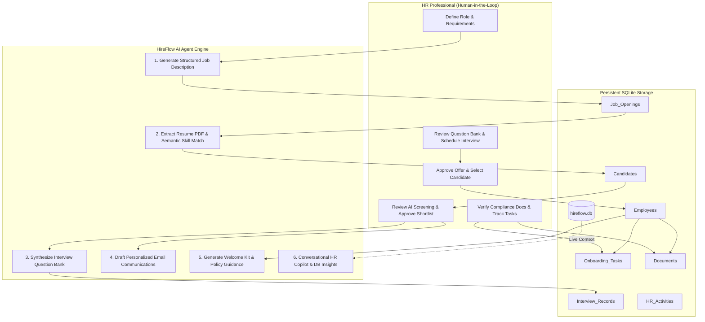

# 💼 HireFlow AI – Intelligent Recruitment & Employee Onboarding System

> **Academic Course Project**: AI Agents & Autonomous Business Operations  
> **Architecture**: Autonomous Multi-Stage HR Agent with Human-in-the-Loop Oversight  
> **Tech Stack**: Python 3, Streamlit, SQLite, Plotly, Pandas, PDFPlumber / PyPDF2, Google Gemini API

---

## 📌 Executive Summary

**HireFlow AI** is a modern, AI-powered web application that automates repetitive, time-consuming HR recruitment and employee onboarding operations. Designed specifically for the course **AI Agents & Autonomous Business Operations**, it demonstrates how intelligent agents can automate candidate extraction, skill matching, interview question synthesis, and onboarding workflows while strictly preserving **human control over high-stakes hiring decisions**.

---

## 🏗️ System Architecture & Workflow



---

## 🌟 Core Features & Modules

### 1. 📊 Executive Operations Dashboard
- **Real-Time KPIs**: Total Candidates, Shortlisted, Interviews Scheduled, Selected, Active Employees, Pending Onboarding Tasks.
- **Interactive Visualizations**: Plotly Recruitment Funnel chart and Candidate Status distribution donut chart.
- **Live Audit Trail**: Chronological activity feed tracking both Human Admin and AI Agent operations.
- **Onboarding Progress Gauge**: Real-time completion progress tracking per active employee.

### 2. 📋 Recruitment Management
- **AI Job Description Generator**: Generate complete, structured job descriptions (Overview, Responsibilities, Requirements, Perks) based on Job Title, Department, Skills, Experience, and Salary.
- **Human-in-the-Loop Editing**: HR can edit and refine the AI draft before persisting to the SQLite database.
- **Pipeline Tracker**: Filter candidates by opening and status (`Applied`, `Shortlisted`, `Interview Scheduled`, `Selected`, `Rejected`).

### 3. 📄 Resume Screening & Skill Matching
- **Automated PDF Parsing**: Extracts Candidate Name, Contact, Education, Experience, and Skills using `pdfplumber` and `PyPDF2`.
- **Intelligent Scoring**: Evaluates candidate profile against job requirements to produce a 0–100% Match Score.
- **Visual Gap Analysis**: Highlights **Matching Skills** (green tags) and **Missing Skills** (red tags).
- **AI Recommendation**: Classifies candidate as `Strong Match`, `Potential Match`, or `Low Match` with executive summary.
- **Preloaded Sample Resumes**: Includes **50+ realistic, pre-generated PDF resumes** in `sample_resumes/` covering Python Developers, Data Analysts, HR Specialists, Full Stack Developers, and Cloud SREs for immediate testing.

### 4. 🎯 Interview Assistant
- **Tailored Question Bank Generator**: Synthesizes 3 distinct interview modules:
  1. *Technical & Domain Evaluation* (with evaluation criteria and expected answers).
  2. *Behavioral Situational Assessment* (using STAR methodology).
  3. *HR & Cultural Alignment* (work style, retention, communication).
- **Interview Scheduler**: Links interview records to candidates and automatically updates pipeline stage.

### 5. ✉️ Communications Hub
- **Automated Drafts**: AI writes personalized emails for:
  - Application Acknowledgement
  - Shortlisting Notifications
  - Interview Invitations (with meeting link placeholders)
  - Selection & Job Offer Letters
  - Polite Rejections
- **Human Review Check**: Explicit authorization check required before marking emails as dispatched.

### 6. 👥 Employee Management
- **One-Click Candidate-to-Employee Conversion**: Automatically converts selected candidates into formal employee records with generated Employee IDs (`EMP-2026-XXX`).
- **Personnel Directory**: Centralized directory displaying departments, designations, joining dates, and managers.

### 7. 🚀 Onboarding Management
- **Document Compliance Tracker**: Tracks submission status (`Pending`, `Submitted`, `Verified`, `Rejected`) for 7 standard compliance documents (Aadhaar/PAN, Resume, Certificates, Bank Details, Photograph, Offer Letter, Agreement).
- **Task Tracker**: Interactive checklist covering 7 standard onboarding tasks (IT setup, ID card, orientation, etc.).
- **AI Welcome Kit**: Generates tailored Day-1 schedule, 30-day goals, and orientation guides.
- **HR Policy FAQ**: Answers employee questions on leaves, working hours, hybrid policy, health insurance, and probation.

### 8. 🤖 AI HR Assistant (Chatbot)
- Interactive conversational copilot with real-time awareness of database stats, open jobs, and candidate stages.
- Pre-configured quick-prompt pills for demonstration.

---

## 📂 Project Structure

```
Final Project 3/
├── app.py                     # Streamlit frontend & interactive SaaS interface
├── database.py                # SQLite database management, schema, and sample seeder
├── ai_agent.py                # AI Agent engine (Gemini REST API + Smart Demo Fallback)
├── resume_parser.py           # PDF resume text extraction & attribute parsing
├── generate_50_resumes.py     # Generates 50 realistic sample PDF resumes & seeds database
├── sample_resumes/            # 50+ pre-generated PDF resumes for immediate testing
│   ├── Priya_Sharma_Python_Dev.pdf
│   ├── Rahul_Verma_Data_Analyst.pdf
│   ├── Ananya_Iyer_HR_Specialist.pdf
│   ├── Kavita_Patel_FullStack.pdf
│   └── ... (50+ candidate PDFs)
├── test_workflow.py           # Automated 11-step end-to-end integration test
├── hireflow.db                # SQLite database file (auto-generated)
├── requirements.txt           # Python dependencies
├── .env.example               # Template for optional Gemini API key
└── README.md                  # Complete documentation and setup manual
```

---

## ⚡ Quick Start & Execution Guide

### Prerequisites
- Python 3.9 to 3.13 installed.

### Step 1: Install Dependencies
Open terminal / command prompt in this directory and run:
```bash
pip install -r requirements.txt
```

### Step 2: (Optional) Set Google Gemini API Key
HireFlow AI includes a **Smart Autonomous Demo Engine** that works with 100% functionality out-of-the-box without any API keys.

If you wish to use live Google Gemini models:
1. Copy `.env.example` to `.env`:
   ```bash
   cp .env.example .env
   ```
2. Add your Gemini API key in `.env`:
   ```
   GEMINI_API_KEY=AIzaSy...
   ```
*(You can also configure or change the API key directly inside the app in the Settings tab!)*

### Step 3: Launch the Application
Run the Streamlit application:
```bash
streamlit run app.py
```
The browser will automatically open at: **http://localhost:8501**

---

## 🧪 Verifying the 11-Step Autonomous Workflow

You can verify the entire 11-step academic workflow programmatically at any time by running:
```bash
python test_workflow.py
```

### Live Demonstration Walkthrough:
1. **Step 1 & 2 (Job & JD)**: Go to **Recruitment Management > Job Openings**, enter title "Cloud DevOps Architect", click **Generate & Draft Opening**, review AI draft, and save.
2. **Step 3, 4 & 5 (Screening)**: Go to **Resume Screening**, select the job, and pick `Priya_Sharma_Python_Dev.pdf` from the preloaded dropdown. Watch AI calculate the match score (85%+), highlight matching skills, and generate the summary. Click **Confirm & Save to Recruitment Database**.
3. **Step 6 (Shortlisting)**: Go to **Recruitment Management > Candidate Pipeline**, locate Priya Sharma, and update status to **Shortlisted**.
4. **Step 7 (Interview & Email)**: Go to **Interview Assistant**, generate questions, and schedule. Then go to **Communications Hub** to draft and approve an **Interview Invitation** email.
5. **Step 8 & 9 (Selection & Employee Conversion)**: Update candidate status to **Selected**. In **Employee Management**, select candidate and click **Register Employee**.
6. **Step 10 & 11 (Onboarding & Completion)**: Go to **Onboarding Management**, generate the AI Welcome Kit, verify submitted documents, and complete checklist tasks to reach 100% completion.

---

## 🔒 Ethical AI & Academic Alignment

- **Human-in-the-Loop Principle**: The AI agent acts strictly as an intelligence amplifier and drafter. All hiring decisions, status changes, and communication approvals require explicit human confirmation.
- **Privacy First**: Preloaded data uses mock academic personas. No sensitive personally identifiable information (PII) is exposed or transmitted.
- **Zero-Dependency Demo Mode**: Ensures academic evaluators can review, test, and grade the system instantly without third-party API dependencies or payment setups.

